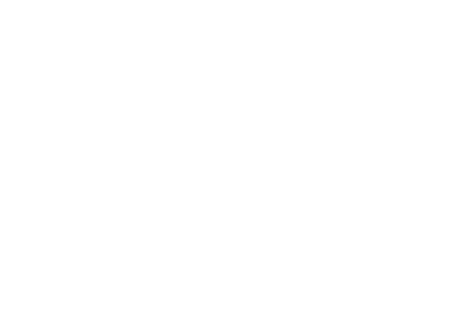

# Who's Actually Decoupling From CO2 Emissions?

## Summary

This project asks which large countries (population above 10 million) have cut per-capita CO2 emissions the most since 2015, and which are still climbing. Using the Our World in Data CO2 and Greenhouse Gas Emissions dataset, I ranked 96 major countries by percentage change in per-capita emissions since 2015 and investigated the three steepest decliners (Yemen, Angola, Netherlands) and three steepest risers (Nepal, Cambodia, Burundi). Only one of the six — the Netherlands — reflects deliberate climate policy; the rest are explained by war, an oil-price collapse, and early-stage economic development, not emissions-reduction effort. The takeaway: a simple percentage-change ranking surfaces dramatic-looking outliers, but without investigating the cause behind each one, it's a poor proxy for genuine climate progress.

## The Question

Among the world's large countries, which have most reduced their per-capita CO2 emissions since 2015 — and which are still climbing? And for the most extreme cases in each direction, is the explanation genuine climate policy, or something else?

## Data

[Our World in Data: CO2 and Greenhouse Gas Emissions](https://github.com/owid/co2-data) — pulled directly from the raw CSV on OWID's GitHub repository. ~50,000 rows, ~79 columns, 1750–2024, country and aggregate rows (continents, income-group buckets, "World") mixed together.

Note: the dataset is read from the live `master` branch rather than a pinned release or commit, so re-running this notebook later will pull whatever the current state of that file is at the time — a known reproducibility tradeoff, not an oversight.

## Methodology

- Removed continent, region, and income-group aggregate rows (e.g. "World," "Africa," "Lower-middle-income countries") from the country-level data, while deliberately keeping Kosovo, which lacks an ISO code for political-recognition reasons rather than a data gap.
- Scoped the analysis to countries with population above 10 million, to keep the per-capita metric statistically meaningful. Validated separately that the excluded smaller countries account for under 5% of global emissions combined — with a few notable exceptions (Kuwait, Qatar, Oman) whose oil-based economies make them large absolute emitters despite small populations.
- For each major country, compared per-capita CO2 emissions in 2015 against the most recent year available, ranking all countries by percentage change since that baseline.
- Investigated the three steepest decliners and three steepest risers individually, researching the historical and economic context behind each rather than taking the ranking at face value.

## Key Findings

Of the six countries with the most extreme per-capita emissions trends since 2015, only the Netherlands represents deliberate climate policy — emissions fell alongside continued GDP growth, consistent with the 2015 and 2019 Urgenda climate rulings, a scheduled coal phase-out, and the 2023 closure of the Groningen gas field. The other two decliners were driven by crises unrelated to climate policy: Yemen's drop followed the outbreak of civil war in 2015, and Angola's followed the 2014 oil price collapse. All three risers reflect economic development rather than policy failure — Nepal and Cambodia are growing off a small industrial base, and Burundi's increase is partly a statistical artifact of 2015 being an unusually low, crisis-depressed starting point. A follow-up check confirmed that despite their large percentage swings, Nepal, Cambodia, and Burundi each account for well under a tenth of a percent of global emissions.

## Hero Chart

Each bubble is a major country: horizontal position shows percentage change in per-capita CO2 since 2015 (left of the line is declining, right is rising), vertical position is population, and bubble size is the country's share of global emissions. The six investigated countries are highlighted in blue (decliners) and red (risers); everything else is shown in gray for scale and context.

## Limitations

- The explanation behind each country's trend comes from external historical research, not from the dataset itself — it's a qualitative layer on top of a quantitative ranking, and only six of the 96 major countries were investigated this deeply.
- The dataset's most recent year(s) may be incomplete for some countries, since real-world emissions reporting lags behind the calendar year.
- The population floor (10 million) is a deliberate scoping choice, not a neutral default — a different cutoff would change which countries appear in the ranking.

## Tools

Python, pandas, matplotlib, seaborn, Jupyter Notebook.

## Files

- `CO2 Project.ipynb` — full analysis notebook
- `hero_chart.png` — exported hero chart (save this from the notebook into the same folder as this README)
